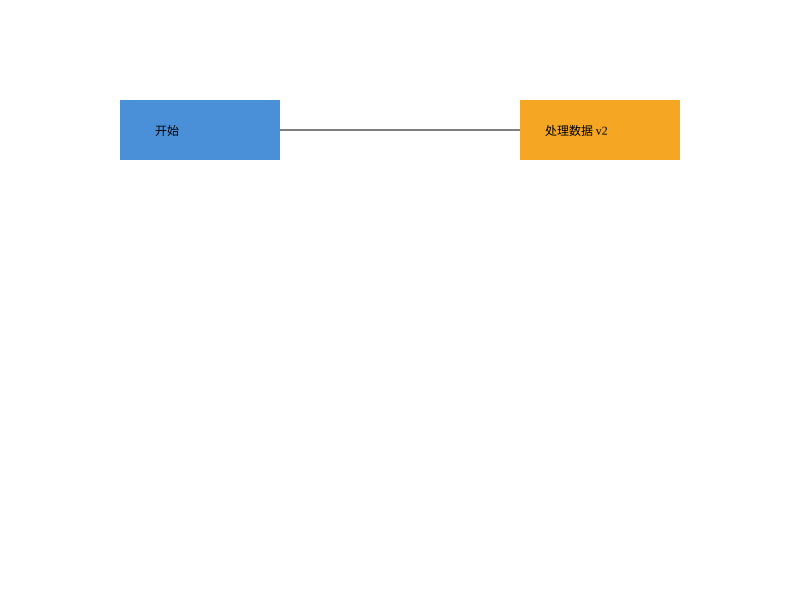

# PJ1 Phase 1 · CLI SVG 编辑器

TypeScript 面向对象实现，支持六种图形、十九条命令、嵌套分组、SVG 读写、原子编辑与撤销重做。

- [项目文档：架构、AI 协作过程、一致性自查、质量保证](doc/README.md)
- [原始任务说明](phase_cli_1.md)
- 远程仓库：<https://github.com/Flowers-zyt/software-design-pj>
- 提交版本：Git 标签 `final`

## 运行

需要 Node.js 22 或更高版本。在项目根目录执行：

```sh
npm ci
npm run cli
```

启动后提示符为 `svg>`；输入 `help` 查看全部语法，Ctrl+C 或 EOF 退出。也可先构建再运行：

```sh
npm run build
npm start
```

最小用例：

```text
init 800 600
create g scene
create rect start 120 100 160 60 #4a90d9 in scene
create text label 155 135 "开始" in scene
move scene 0 100
undo
tree
save demo.svg
```

`demo.svg` 可直接在浏览器打开。

## 示例回放

PowerShell（在项目根目录）：

```powershell
Get-Content -Encoding utf8 examples/flowchart.cli | npm run cli
Get-Content -Encoding utf8 examples/session.cli | npm run cli
```

Linux / macOS：

```sh
npm run cli < examples/flowchart.cli
npm run cli < examples/session.cli
```

`flowchart.cli` 生成 [中文流程图](examples/flowchart.svg)，包含 8 个元素；`session.cli` 复现任务中的完整会话，包含两条预期错误提示。仅整行开头的 `#` 是注释，颜色 `#ffffff` 会保留。



## 验证

```sh
npm run check
```

依次执行严格类型检查、27 项自动化测试、正式构建。测试包括真实 Node.js 子进程运行 CLI、全部编辑的完整撤销与重做、文件失败原子性、SVG 读写一致性和架构依赖检查。GitHub Actions 配置了 Windows / Ubuntu 两个平台的相同检查。

## 阶段范围

内置 `rect`、`circle`、`ellipse`、`line`、`text`、`g`。`box` 属后续插件化阶段，按要求返回 unknown shape type。导入支持这些元素及平移、正向等比缩放；完整 SVG/CSS 渲染、旋转、非等比变换、path、tspan 等不在本阶段支持范围内，不能处理的结构会报错并保留当前文档。详细语义见项目文档。
