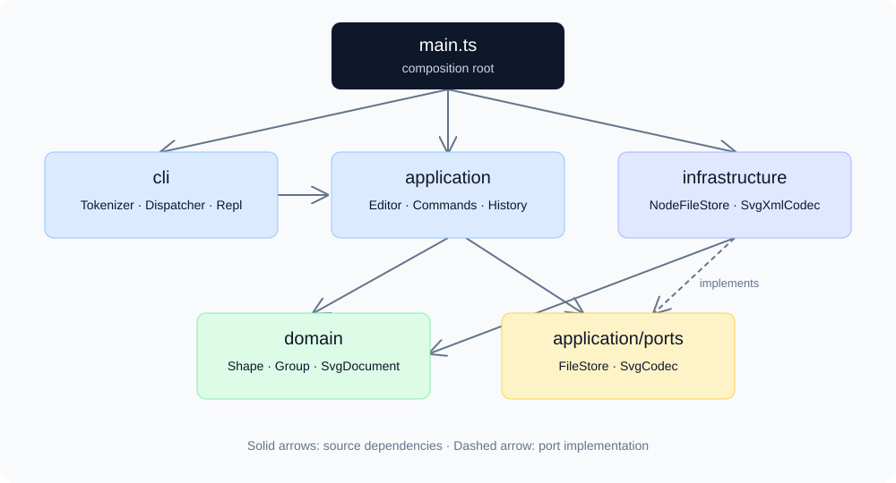
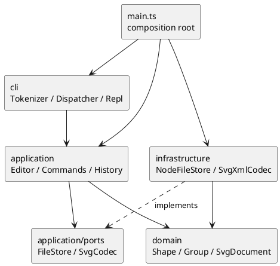

# PJ1 Phase 1 项目文档

本项目用 TypeScript 实现 CLI SVG 编辑器。入口为 `src/main.ts`，运行命令为 `npm run cli`，验证命令为 `npm run check`。代码仓库：<https://github.com/Flowers-zyt/software-design-pj>，提交版本使用 `final` 标签。原始要求见 [phase_cli_1.md](../phase_cli_1.md)。

## 一、架构方案

### 1. 模块划分

项目采用分层设计，业务图形与文件、命令行 IO 分离。所有生产类一类一文件，文件名与类名相同；接口文件承载端口与命令协议。

| 目录 / 文件 | 职责 | 主要类 / 接口 |
|---|---|---|
| `src/domain/` | 图形几何行为、公共属性、树结构及 ID、层级约束 | `Shape`、六种图形类、`Point`、`NumberValue`、`ShapeFactory`、`SvgDocument` |
| `src/application/commands/` | 每条命令的参数检查与应用行为 | `Command`、`EditCommand`、十九个具体命令类 |
| `src/application/` | 当前文档、事务提交、历史屏障、树形显示 | `Editor`、`CommandHistory`、`HistoryEntry`、`TreeFormatter` |
| `src/application/ports/` | 声明应用需要的外部能力 | `FileStore`、`SvgCodec` |
| `src/infrastructure/` | UTF-8 文件读写、XML 转换、导入变换归一化 | `NodeFileStore`、`SvgXmlCodec`、`SvgTransform` |
| `src/cli/` | 双引号词法分析、命令名分发、REPL、统一错误输出 | `Tokenizer`、`CommandDispatcher`、`Repl` |
| `src/main.ts` | 唯一组装入口，连接具体适配器与应用 | 顶层组装代码 |
| `test/` | 领域、命令、SVG、显示、架构和真实 CLI 验收 | Node.js 内置测试运行器 |
| `examples/` | 可回放脚本及 SVG 输入 / 输出示例 | `session.cli`、`flowchart.cli`、`other.svg` |

下图箭头代表源码依赖，接口实现在应用层定义的端口上。



对应 PlantUML 组件图如下，独立源文件见 [architecture.puml](architecture.puml)。



### 2. 设计模式及代码落地

**Command（必需）**：`Command.execute(editor, args)` 统一表示用户动作。每条命令有独立类，例如 `MoveCommand`、`GroupCommand`、`ReadCommand`。十个编辑命令继承 `EditCommand`，由基类进入 `Editor.edit()`，具体子类只实现 `apply(document, args)`。编辑命令不直接操作文件或 REPL，也不自行维护 undo 栈。显示、文档 IO、历史命令实现相同 Command 接口，执行对应应用操作。

**Composite**：抽象 Shape 定义 move、scale、set、children、geometry、summary 等协议。叶子类封装各自坐标和尺寸；Group 封装子节点并递归转发移动、缩放。MoveCommand 和 ScaleCommand 不按图形标签判断，调用多态方法即可处理叶子与任意层级的组。set 对组使用 SVG 原生的 fill / stroke / stroke-width 继承语义，子元素显式指定的样式保留，不强制覆写子孙。删除由文档摘除整个子树。

**Memento**：HistoryEntry 私有持有修改前后快照，恢复时再深复制，避免当前文档污染历史。CommandHistory 管理 past / future 两个栈。组内批量操作对应一个历史单元。选择快照是为了让分组、删除、重新归属、z-order 等结构编辑可靠恢复，无须为每个操作另写逆向逻辑。

**Factory**：ShapeFactory 集中维护类型名到具体图形类的映射。创建、SVG 读回、深复制共用该工厂。XML 适配器没有第二套 `switch(tag)`；各类自身解析几何字段，行为封装在对象中。

**端口与适配器**：Editor 通过构造器获得 FileStore、SvgCodec 接口。实际运行注入文件系统与 XML 适配器；测试可注入内存文件系统。无须模拟命令行或触碰磁盘即可测试大多数应用语义。

**事务执行**：编辑先深复制工作文档，完成检查和修改，构造完整前后快照后，才提交当前文档并清空 redo。如果递归缩放到第二个子节点发生数值溢出，工作副本会被丢弃，当前文档和历史均保持原状。

按命令名或图形类型名进行实现分派只有两处：CommandDispatcher 和 ShapeFactory。两处目前显式注册内置实现，均列为后续插件阶段的待重构项。属性白名单、数值解析和 transform 语法校验不承担图形类型分派。阶段 1 没有实现动态插件加载，不声称已经达成后续阶段“内核新增代码为 0”的目标。

### 3. 依赖方向规则

| 源模块 | 允许依赖 | 禁止依赖及理由 |
|---|---|---|
| domain | 本目录内的领域对象 | application、cli、infrastructure、Node.js、XML 库；保持几何与树操作独立 |
| application | domain、本层端口和命令 | cli、infrastructure、Node.js、XML 库；不绑定输入输出设备 |
| infrastructure | domain、application/ports、Node.js、XML 库 | cli、具体命令；文件与 XML 不决定用户动作 |
| cli | application、Node.js 的流 / readline | infrastructure 的具体适配器；具体实现由 main 注入 |
| main.ts | 以上模块 | 只组装，不承载几何和编辑规则 |

Command 和 EditCommand 中对 Editor 的引用为类型导入；Editor 对编辑命令也使用类型导入，不产生互相构造的运行时循环。

### 4. 变化点假设

| 可能变化 | 当前预留 / 暂不预留的原因 |
|---|---|
| 增加 CLI 命令 | 新增 Command 类并在 Dispatcher 注册，复用历史机制；后续可将显式注册提取为命令注册端口 |
| 增加图形，例如 box | Shape、Composite 和工厂提供基础；当前结构操作面向内置 Group，插件阶段需增加 ShapeProvider 和容器协议，暂不虚构完整插件框架 |
| GUI / agent 作为输入 | 应用操作与 stdin/stdout 解耦，可复用 Editor 和命令对象，另加输入适配器 |
| 其他格式、云存储 | 通过 SvgCodec / FileStore 注入新适配器；当前为同步接口，异步远程 IO 需要另行演进 |
| 大文档、长历史 | 当前查找使用遍历，历史采用全树快照，空间约 O(历史步数 × 元素数)。课程规模优先保证正确性，未引入索引缓存和增量历史 |
| 完整 SVG / CSS | 保留基本表现属性和 viewBox，用 DOM 处理 XML；不实现 path、CSS 计算样式、旋转、tspan 等完整渲染体系 |

### 5. 具体语义决策

- ID 大小写敏感且全树唯一；CLI create / group 必须命名。读入先保留全部显式 ID，再按标签名 + 序号补缺失 ID，避免与文件后部元素碰撞，成功读入才输出 warning。
- group 按原文档深度优先遍历顺序收编，而非命令参数顺序。同父分组放在第一个被选节点的位置；跨父分组放在根级第一个被选节点所属分支的位置。规范未唯一指定跨父组的新父级，在此明确约定。
- 同时选择祖先与子孙、重复成员、把容器移入自身或子孙均拒绝，保证无环。
- ungroup 仅允许嵌套 g；根级 g 按任务要求拒绝。子节点在原组位置依序提升，并将组上的常见可继承绘制 / 文本属性补给未覆盖的子节点。
- SVG 按子节点顺序绘制；front 移到同级数组末端，back 移到开头，不改变父级。
- scale 围绕原点，对位置和尺寸全部同乘正因子，组递归处理。公共绘制属性 stroke-width 和非白名单 font-size 不属于 CLI 几何缩放字段。
- init 默认 800×600，仅给宽度时高度默认 600。canvas 无参数只显示，有参数需同时提供宽高；画布宽高为有限正数，形状尺寸允许为 0，负数尺寸拒绝。
- 成功的 init / read / save / canvas 修改尺寸清空历史并建立屏障；undo、redo 均报 `error: undo not allowed after io command`，直到下一条成功编辑解禁。canvas 查询和显示命令不建立屏障；失败 IO 不改变历史。
- 成功 read / 显式 save 后记住保存路径；无路径 save 复用该路径。init 清除路径。保存先写同目录临时文件，成功重命名后才更新路径和历史屏障。
- 双引号支持空字符串、空格、中文和引号转义；引号内仅将 `\"`、`\\` 视作转义，其余反斜杠保留，兼容 Windows 路径。仅整行开头 # 为注释，不误删颜色值。
- 错误统一由 CLI 转为一行 error 输出。撤销 / 重做使用 undone: / redone: 标记原操作，恢复后的真实属性可用 show / tree 查看。

## 二、与 AI 协作的过程记录

本节记录实际过程。用户提供任务、指定远程仓库，并要求协助配置新 GitHub 账号；代码、测试、设计分析及文档由 Codex 辅助完成。以下技术检查由智能体执行，不虚构为用户手工发现的问题。

| 时间 / 阶段 | 讨论、发现与处理 | 验证证据 |
|---|---|---|
| 2026-10-20 · 读取要求 | 初始目录只有任务说明。确认必须 TypeScript、面向对象、一类一文件、Command、Composite，并区分阶段外 box | 首次提交保存工程配置和初始架构方案 |
| 图形模型 | 坐标与几何行为封装进具体类；对 group 顺序的歧义，选择原树顺序并记录；领域层独立于 Node 和 XML | 4 项领域测试通过 |
| 命令与历史 | 防止先改一部分再报错，采用副本事务和快照历史。构造第二个后代数值溢出的情况，验证前一个后代不受影响；显示与失败命令保留 redo | 扩展到 9 项测试，类型检查通过 |
| SVG 与 REPL | 单遍补 ID 可能碰撞后续显式 ID，改为两遍扫描；XML 用 DOM，保存用临时文件 + rename。保留 viewBox，额外支持平移 / 正向等比变换归一化 | 17 项测试及构建通过，中文流程图真实回放输出 8 个元素 |
| 类型修正 | XML 库 Element.localName 可空，首次类型检查报错；改为 localName / tagName 回退，没有关闭 strict | 类型检查重新通过 |
| 验收扩展 | 加入每次编辑后的 SVG 读回、22 次编辑完整撤销再重做、精确错误、错误参数、真实 CLI 子进程和架构 AST 检查 | 27 项测试通过 |
| 依赖版本修订 | 最初安装的 TypeScript 7 包不提供测试所用 compiler API，架构测试无法编译；固定 TypeScript 5.9.3 并更新 lockfile | AST 检查、全部测试和正式构建通过 |
| 结构语义修订 | 检查发现 ungroup 不应将所有 XML 附加属性当作继承属性；改成明确的绘制 / 字体属性集合，并验证子元素显式颜色优先 | presentation 测试覆盖继承、覆盖、位置与 undo 恢复 |
| 远程提交准备 | 首次 HTTPS 推送因现有本机账号无仓库权限返回 403。按用户要求准备独立 SSH 身份；用户手动添加公钥后，SSH 成功认证为 Flowers-zyt | 私钥不纳入工程；发布结果另用 git push 与远程引用核对 |
| 最终复核 | 重新 npm ci 后运行完整检查；代码验证提交 252b685 已推送并触发真实远程 CI | 本地 27 项通过；GitHub Actions 的 Ubuntu / Windows 两个作业均成功 |

提交按工程与方案、领域模型、命令与历史、SVG 与 CLI、验收修订、最终文档逐步推进。可用 `git log --oneline --reverse` 检查，不修改提交时间或事后伪造开发历史。

## 三、实现后的一致性自查

### 1. 模块划分是否一致

实际目录与初始四层方案一致。application/commands 与 application/ports 是应用层内部细分；新增 SvgTransform 属基础设施导入辅助；Point / NumberValue 属领域值对象和校验支持，职责未跨层迁移。示例、测试和 CI 独立放置。

相对初始方案的修订已记入过程表：两遍 ID 扫描、导入变换归一化、架构检查、TypeScript 固定，以及 ungroup 继承白名单。没有未说明的模块拆并。

### 2. 依赖方向是否违反

`test/architecture.test.ts` 解析生产源码 AST，自动校验 domain 仅导入本目录、application 仅导入 domain / application，以及每文件最多一个类且文件名匹配；检查通过。

人工抽样的依赖如下：

| 文件 | 实际依赖 | 结论 |
|---|---|---|
| domain/Rectangle.ts | Shape、Point、NumberValue | 仅领域层 |
| domain/SvgDocument.ts | Group、Shape、ShapeFactory、NumberValue | 仅领域层 |
| application/commands/MoveCommand.ts | NumberValue、SvgDocument、EditCommand | 应用 → 领域 |
| application/Editor.ts | SvgDocument、FileStore / SvgCodec 接口、CommandHistory、EditCommand 类型 | 应用未绑定文件系统 / XML |
| infrastructure/SvgXmlCodec.ts | SvgCodec 接口、领域模型、xmldom、SvgTransform | 基础设施 → 端口 / 领域 |
| cli/Repl.ts | node:readline、流类型、CommandDispatcher | 输入输出适配 |
| main.ts | Editor、Dispatcher、Repl、两个具体适配器 | 组装根的预期依赖 |

无已知违反分层规则的导入。NumberValue.count 还承担创建参数数量检查，是当前小型校验复用；后续 schema 演进可将参数解析从图形创建静态方法中进一步提取。全树快照、遍历查找与显式工厂注册均是已说明的阶段取舍。

## 四、功能完整性与质量保证

### 1. 功能核对

| 任务功能 | 实现与验证 |
|---|---|
| init / read / save / canvas | 默认画布、正数校验、记忆路径、外部 SVG、补 ID、viewBox、原子保存与失败保护 |
| 六种 create 及 in | 每类独立构造和几何实现，六类均可指定已有 g；省略 fill / stroke 不写属性 |
| delete / move / scale / set | 叶子与容器统一调用、嵌套递归、每类几何白名单、公共样式和 text 内容 |
| group / ungroup / addto | 保持顺序、跨父级、嵌套解组、根组拒绝、循环检测及单步恢复 |
| front / back | 同级 z-order，可撤销重做 |
| tree / show / help | Unicode 连接线、关键几何、子树、父级与明细、完整语法 |
| undo / redo | 一个编辑一个单元，成功新编辑清空 future；显示 / 失败保留；文档 IO 屏障 |
| CLI 通用约定 | svg>、逐行、双引号、整行注释、中文、单行 error、EOF 退出 |
| box | 按阶段边界拒绝 unknown shape type；没有将阶段 2 声称为已完成 |

### 2. 已执行检查

环境：Windows，Node.js 22.14.0。执行 `npm run check`，结果为严格类型检查通过、27 项测试全部通过、正式 TypeScript 构建通过。

| 测试文件 | 项数 | 重点 |
|---|---:|---|
| domain.test.ts | 4 | 多态几何、深复制、树顺序、循环、ID、数值与白名单 |
| commands.test.ts | 5 | 词法、事务、历史屏障、递归溢出回滚、结构与 z-order |
| svg.test.ts | 8 | 七元素样例、ID 碰撞、转义、中文、失败读写、viewBox、变换、原子保存 |
| acceptance.test.ts | 6 | 22 步编辑全量 undo / redo、全部可设属性、错误参数、真实 CLI |
| presentation.test.ts | 3 | tree / show 精确格式、解组继承、交互提示符 |
| architecture.test.ts | 1 | AST 依赖边界与一类一文件 |

tsconfig 开启 strict、noUncheckedIndexedAccess、exactOptionalPropertyTypes 等。package-lock 固定依赖解析结果，使用 npm ci 重现。GitHub Actions 对 Ubuntu / Windows 执行相同检查。代码验证提交 252b685 的两个远程作业均成功，记录见 [CI 运行 39420864892](https://github.com/Flowers-zyt/software-design-pj/actions/runs/39420864892)。最终文档提交对应的运行可在仓库 Actions 中继续核对。

### 3. 示例及检查方法

在项目根目录执行：

```powershell
npm ci
npm run check
Get-Content -Encoding utf8 examples/flowchart.cli | npm run cli
Get-Content -Encoding utf8 examples/session.cli | node dist/main.js
```

第一个脚本输出 8 个元素的中文流程图；第二个复现任务会话，预期包含祖先 / 子孙分组错误和保存后的撤销屏障错误。自动验收检查两条预期错误并确认后续 read / tree 正常。测试临时输出独立于仓库示例文件。

SVG 使用标准 XML DOM 生成并进行读回一致性校验，示例可在浏览器打开。当前没有跨浏览器像素截图比较或性能压测，不将语义测试等同于完整渲染引擎验证。

### 4. 已知限制

- 支持 Phase 1 六种元素；其他元素、嵌套 tspan、DTD、非 SVG 命名空间、旋转 / 非等比变换明确报错。translate / 正向等比 scale 读入时归一化为几何坐标，并处理数值字体及描边缩放。
- 普通附加 XML 属性可保留，但不计算完整 CSS、滤镜、组透明度等高级渲染语义；其结构编辑后的完整视觉等价性不在当前保证范围内。
- 浮点采用 JavaScript number，非有限数和溢出拒绝，不提供任意精度十进制运算。
- 每步存完整文档快照，适合课程规模，没有做超大文档与无限历史优化。
- Git push、远程 CI 与课程系统上传是独立步骤。本地检查与 final 标签不能替代远程引用验证或课程网站提交。
